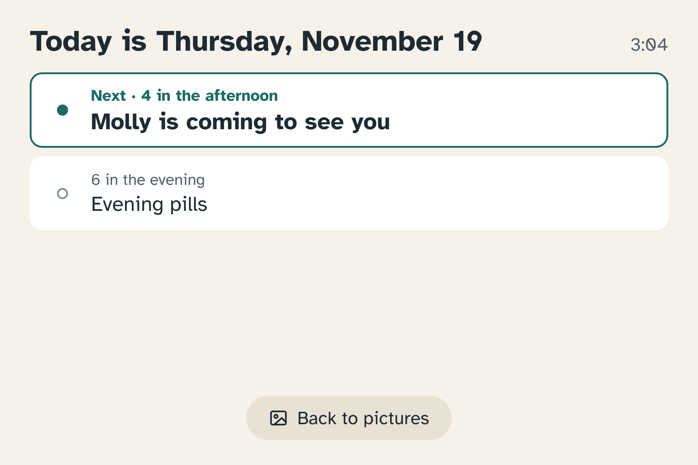
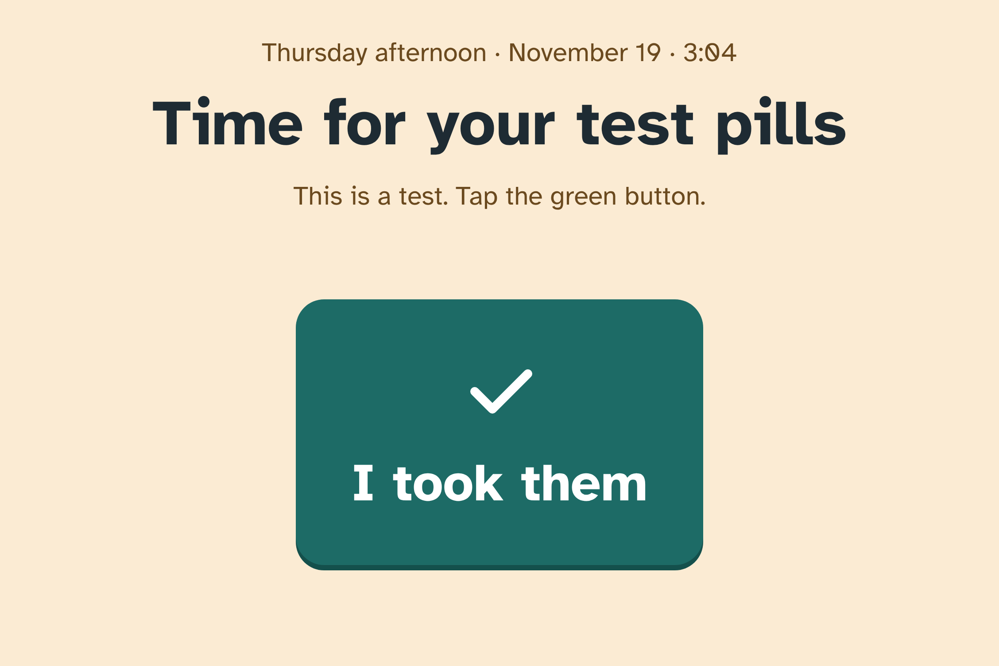
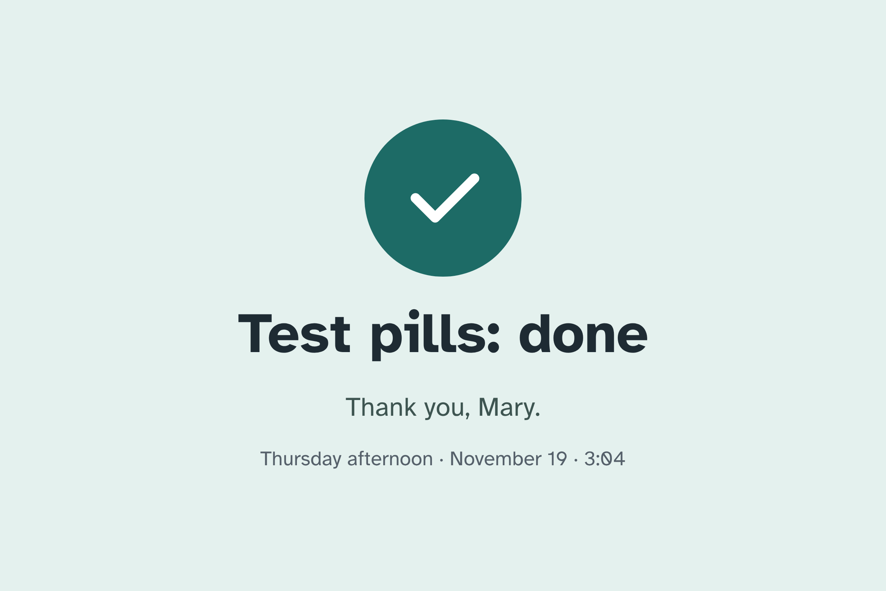

# Mary's helper kiosk

A picture frame for Mary that also keeps her oriented, shows her day, and reminds her to take her pills, with Gary alerted on his Pixel when a dose goes unconfirmed. It runs on an Acer Chromebook 713 in tent mode as a full-screen web app, served by one Cloudflare Worker.

The spec and the screen mockups are the source of truth for behaviour and look:
[spec](https://claude.ai/artifact/K57eXxiatQcpppEQsm9KJq) · [screens](https://claude.ai/artifact/HVf8ThLPEtNsRxqWVxEgxr).

| Frame | Menu | Today |
|---|---|---|
|  |  |  |
| **Coming up** | **Reminder** | **Done** |
|  |  |  |

## How it fits together

```
Chromebook (kiosk PWA)  ──device token──▶  Worker  ──▶ D1 (events, schedule, dose log, heartbeats, alerts)
                                             │  ├──▶ R2 (photos, pillbox photos; private)
Gary's browser (/admin) ──Cloudflare Access─▶│  ├──▶ Google Calendar API (read-only, every 15 min)
                                             │  └──▶ ntfy or Pushover ──▶ Gary's Pixel
                                Cron, every minute: dose watcher, kiosk-offline check, sync
```

| Path | What |
|---|---|
| `src/index.ts` | Routes (kiosk API, admin API, Google sign-in) and the cron handler |
| `src/doses.ts` | Dose rows, the watcher (re-remind, alert at the window), confirmations, overrides, test doses |
| `src/calendar.ts` | Google OAuth, the `(Mary)` event sync, the mock source |
| `src/alerts.ts` | ntfy / Pushover delivery; every alert is also logged in D1 |
| `src/access.ts` | Verifies the Cloudflare Access JWT on admin routes |
| `public/app/` | The kiosk: `app.js` (screens and loop), `style.css` |
| `public/app/shared/` | Wording ("11:30 in the morning") and dose logic, used by both the kiosk and the Worker |
| `public/admin/` | Gary's admin page |
| `mock/events.json` | Phase 2 mock calendar (`CALENDAR_SOURCE=mock`) |
| `migrations/` | D1 schema |
| `docs/dry-run.md` | The medication dry-run plan |

### Behaviour worth knowing

- **Doses** are created a day ahead from the schedule, so the kiosk can run a whole day offline from its cache. A dose turned on or moved after its time has passed starts the next day (no surprise alerts).
- **Reminder**: at the dose time the reminder covers any screen with a chime. At +30 min it chimes again. At +60 min (the "window") Gary gets a push. The reminder stays up for 3 hours by default ("Reminder stays up" in the admin page), then quietly goes away; a missed dose never shows Mary an error.
- **Double-dose guard**: once she taps **I took them** (even offline), that dose can't remind again, and the frame strip shows "Noon pills done" until the next dose comes due. If Gary was already alerted and her tap arrives later, he gets a "confirmed late" follow-up.
- **Gary's overrides**: Mark done, Skip, or Undo any dose in the admin page.
- **Proactive Today**: shown once each morning (default 8:30) and 60 minutes before each timed event, then back to the frame after 60 s.
- **Offline**: photos, today's items and dose times are cached; taps are queued and sent on reconnect. The server alerts Gary after 15 minutes without a heartbeat, and after 2 failed calendar syncs in a row.
- **Nightly reload** at 3 AM picks up new versions.
- **Event-linked photos**: a photo's "People" (e.g. Molly) are matched against today's event text; matching photos come up every other turn.

## Deploy

You need Node 20+ and a Cloudflare account (the free plan is enough). Run everything from this folder.

### 1. Install and sign in

```sh
npm install
npx wrangler login
```

### 2. Create the database and photo bucket

```sh
npx wrangler d1 create mary-kiosk
```

Copy the `database_id` it prints into `wrangler.jsonc` (replace `REPLACE-WITH-ID-FROM-wrangler-d1-create`). Then:

```sh
npm run db:migrate
npx wrangler r2 bucket create mary-kiosk-photos
```

### 3. Set the variables in `wrangler.jsonc`

- `PUBLIC_URL`: the Worker's address, e.g. `https://mary-kiosk.<your-subdomain>.workers.dev` (check the subdomain in the Cloudflare dashboard under Workers).
- `TIMEZONE`: Mary's time zone, e.g. `America/Los_Angeles` or `America/New_York`. Every dose time and "Tuesday morning" uses it.
- `CALENDAR_SOURCE`: start with `"mock"` if you want to try phase 2 before connecting Google; switch to `"google"` after.
- `ALERT_PROVIDER`: `"ntfy"` (recommended, free) or `"pushover"`.
- `ACCESS_TEAM_DOMAIN` and `ACCESS_AUD`: filled in at step 6.

### 4. Set the secrets

```sh
# A long random key the kiosk uses. Any 40+ random characters:
openssl rand -base64 36 | npx wrangler secret put KIOSK_TOKEN
# Encrypts the Google refresh token stored in D1:
openssl rand -base64 32 | npx wrangler secret put TOKEN_ENCRYPTION_KEY
```

### 5. Phone alerts (Pixel)

**ntfy** (recommended): install the ntfy app from the Play Store. Pick a long, unguessable topic name (anyone who knows it can read the alerts), e.g. `openssl rand -hex 16` prefixed with `mary-`. In the app, subscribe to that topic, and in the topic's settings turn on "Instant delivery" and allow high-priority notifications to make sound. Then:

```sh
npx wrangler secret put NTFY_TOPIC
```

**Pushover** instead: create an application at pushover.net, set `"ALERT_PROVIDER": "pushover"`, then `npx wrangler secret put PUSHOVER_TOKEN` (the app token) and `PUSHOVER_USER` (your user key).

### 6. Deploy, then lock the admin page with Cloudflare Access

```sh
npm run deploy
```

In the Cloudflare dashboard, open **Zero Trust** (free for up to 50 users) and pick a team name. Then **Access → Applications → Add an application → Self-hosted**:

- Application domain: your `workers.dev` host, with **three** paths: `admin`, `api/admin`, `oauth`.
- Identity provider: Google (or one-time PIN to your email).
- Policy: Allow, Emails: your Google address only.

Copy the application's **Audience (AUD) tag** into `ACCESS_AUD`, and set `ACCESS_TEAM_DOMAIN` to `https://<team>.cloudflareaccess.com`. Deploy again. The Worker checks the Access token itself as well, so the admin routes stay closed even if the Access app is misconfigured.

### 7. Connect Google Calendar (read-only)

In Google Cloud Console:

1. Create a project, then **APIs & Services → Library → Google Calendar API → Enable**.
2. **OAuth consent screen**: External, add yourself as a test user, add the scope `.../auth/calendar.readonly`. Then **Publish app** (to "In production"). In "Testing" mode Google expires the refresh token after 7 days and sync would stop. Unverified is fine for your own account; you'll click through a warning once.
3. **Credentials → Create credentials → OAuth client ID → Web application**. Authorized redirect URI: `https://<your worker>/oauth/google/callback`.

```sh
npx wrangler secret put GOOGLE_CLIENT_ID
npx wrangler secret put GOOGLE_CLIENT_SECRET
```

Set `CALENDAR_SOURCE` to `"google"` and deploy. Open `https://<your worker>/admin/`, click **Connect Google Calendar**, and approve. Events whose title starts with `(Mary)` appear under **Events** within a minute. If they live on a calendar other than your main one, set `CALENDAR_ID` to that calendar's ID (Google Calendar → Settings → the calendar → Integrate calendar).

### 8. Fill in the admin page

- **Photos**: upload, caption ("Molly, your niece"), and People for event-linked photos.
- **Medication schedule**: set the three times, upload a photo of each pillbox compartment, tick **On**, Save. Nothing reminds until a dose is on.
- **Settings**: Coming up 3 or 7 days, morning Today time, minutes before events.
- **Events**: add display text where the calendar title isn't what Mary should read.

### 9. Set up the Chromebook

1. Check its Auto Update Expiration date: Settings → About ChromeOS → Additional details.
2. Plug it in. Settings → Device → Power: **When idle: Keep display on** (for both charging and battery), and turn off "Sleep when cover is closed".
3. Sign in with the dedicated Google account (spec option A).
4. In the admin page, **Kiosk setup → Show setup link**, and open that link once in Chrome on the Chromebook. It stores the key and removes it from the address bar.
5. Chrome menu → **Cast, save and share → Install page as app**. Open the installed app, then make it full screen (the full-screen key, or right-click its shelf icon → New window → Full screen). Add the app to Settings → Apps → **Startup**, or pin it, so it comes back after a restart.
6. Tap the screen once after each start: that unlocks the chime, which ChromeOS blocks until a first touch. (With option B, the managed kiosk license, autoplay can be allowed by policy.)
7. Turn the volume to low-medium, flip into tent mode, and watch for the first heartbeat under Status.

### 10. Do the dry run

Before anyone relies on the medication loop, follow [docs/dry-run.md](docs/dry-run.md).

## Local development

```sh
cp .dev.vars.example .dev.vars
npm run db:migrate:local
npm run dev
```

Open http://127.0.0.1:8790/admin/ (Access is bypassed locally by `ADMIN_DEV_BYPASS=1`), turn on the doses, then open http://127.0.0.1:8790/#setup=dev-kiosk-token-change-me for the kiosk. The mock calendar is used locally. `curl http://127.0.0.1:8790/__scheduled` runs the cron once.

```sh
npm test          # wording and dose logic
npm run type-check
```

When you change kiosk code, bump `APP_VERSION` in both `src/env.ts` and `public/app/app.js`, and the cache name in `public/sw.js` if you add files.

## Not built yet

The optional MCP endpoint (asking Claude "Did Mary take her noon pills?") from phase 4. It needs the same OAuth setup as the Spotify MCP server rather than Cloudflare Access, so it's a separate piece of work. The menu has room for a third button when one is wanted.
