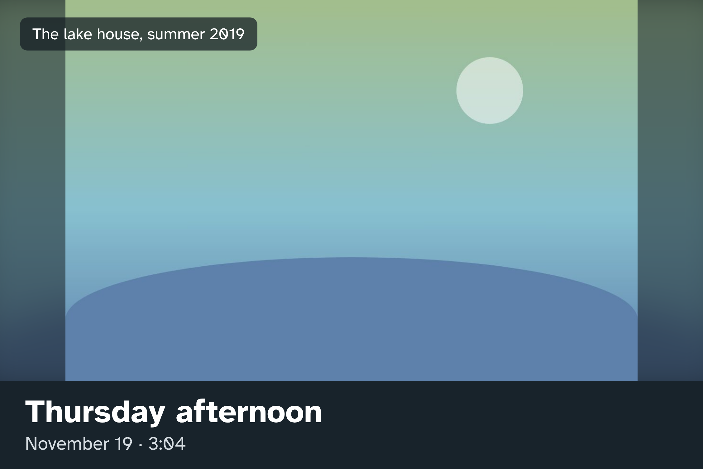
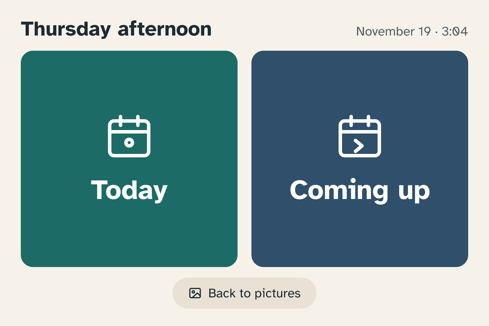
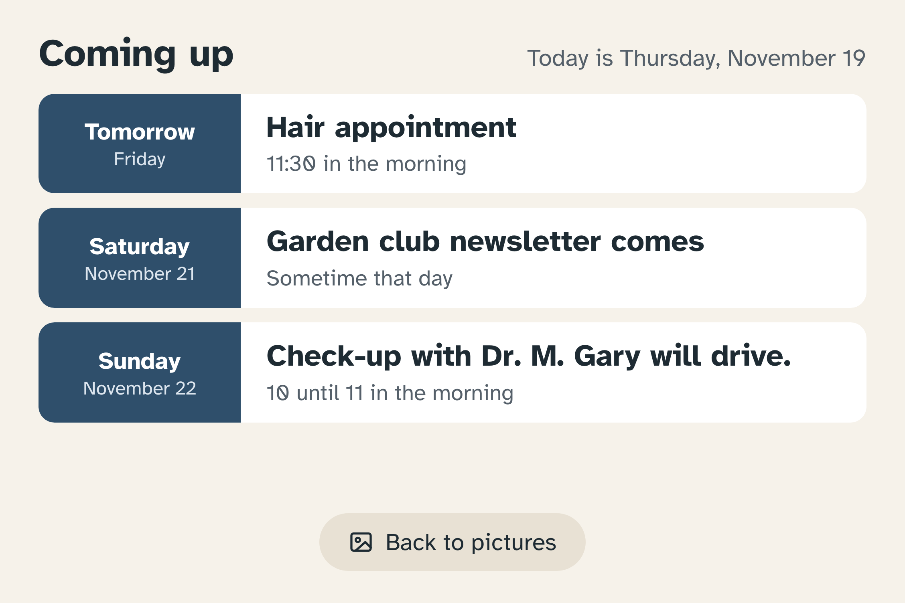

# Mary's helper kiosk

A picture frame for Mary that also keeps her oriented, shows her day, and reminds her to take her pills, with Gary alerted on his Pixel when a dose goes unconfirmed. It runs on an Acer Chromebook 713 in tent mode as a full-screen web app, served by one Cloudflare Worker.

The spec and the screen mockups are the source of truth for behaviour and look:
[spec](https://claude.ai/artifact/K57eXxiatQcpppEQsm9KJq) · [screens](https://claude.ai/artifact/HVf8ThLPEtNsRxqWVxEgxr).

| Frame | Menu | Today |
|---|---|---|
|  |  |  |
| **Coming up** | **Reminder** | **Done** |
|  |  |  |

## How it fits together

```
Chromebook (kiosk PWA)  ──device token──▶  Worker  ──▶ D1 (events, schedule, dose log, heartbeats, alerts)
                                             │  ├──▶ R2 (photos, pillbox photos; private)
Gary's browser (/admin) ──Cloudflare Access─▶│  ├──▶ Google Calendar API (read-only, every 15 min)
                                             │  └──▶ ntfy or Pushover ──▶ Gary's Pixel
                                Cron, every minute: dose watcher, kiosk-offline check, sync
```

| Path | What |
|---|---|
| `src/index.ts` | Routes (kiosk API, admin API, Google sign-in) and the cron handler |
| `src/doses.ts` | Dose rows, the watcher (re-remind, alert at the window), confirmations, overrides, test doses |
| `src/calendar.ts` | Google OAuth, the `(Mary)` event sync, the mock source |
| `src/alerts.ts` | ntfy / Pushover delivery; every alert is also logged in D1 |
| `src/access.ts` | Verifies the Cloudflare Access JWT on admin routes |
| `public/app/` | The kiosk: `app.js` (screens and loop), `style.css` |
| `public/app/shared/` | Wording ("11:30 in the morning") and dose logic, used by both the kiosk and the Worker |
| `public/admin/` | Gary's admin page |
| `mock/events.json` | Phase 2 mock calendar (`CALENDAR_SOURCE=mock`) |
| `migrations/` | D1 schema |
| `docs/dry-run.md` | The medication dry-run plan |
| `.github/workflows/deploy.yml` | Tests, sets up Cloudflare and deploys on every merge to `main` |

### Behaviour worth knowing

- **Doses** are created a day ahead from the schedule, so the kiosk can run a whole day offline from its cache. A dose turned on or moved after its time has passed starts the next day (no surprise alerts).
- **Reminder**: at the dose time the reminder covers any screen with a chime. At +30 min it chimes again. At +60 min (the "window") Gary gets a push. The reminder stays up for 3 hours by default ("Reminder stays up" in the admin page), then quietly goes away; a missed dose never shows Mary an error.
- **Double-dose guard**: once she taps **I took them** (even offline), that dose can't remind again, and the frame strip shows "Noon pills done" until the next dose comes due. If Gary was already alerted and her tap arrives later, he gets a "confirmed late" follow-up.
- **Gary's overrides**: Mark done, Skip, or Undo any dose in the admin page.
- **Proactive Today**: shown once each morning (default 8:30) and 60 minutes before each timed event, then back to the frame after 60 s.
- **Offline**: photos, today's items and dose times are cached; taps are queued and sent on reconnect. The server alerts Gary after 15 minutes without a heartbeat, and after 2 failed calendar syncs in a row.
- **Nightly reload** at 3 AM picks up new versions.
- **Event-linked photos**: a photo's "People" (e.g. Molly) are matched against today's event text; matching photos come up every other turn.

## Deploy

Everything happens in the Cloudflare and GitHub websites. You don't need wrangler, Node or a terminal. A GitHub Action (`.github/workflows/deploy.yml`) does the work:

- It runs the tests.
- It creates the D1 database and R2 photo bucket if they're missing, and applies database migrations.
- It generates the kiosk key once, copies your other secrets to the Worker, and deploys.
- It runs on every merge to `main`, and whenever you press **Run workflow**. After you change a secret or variable, press **Run workflow** so the change takes effect.

### 1. Prepare Cloudflare (once)

1. Sign in at [dash.cloudflare.com](https://dash.cloudflare.com). The free plan is enough.
2. Open **Workers & Pages** once. If it asks you to choose a `workers.dev` subdomain, pick one. The kiosk will live at `https://mary-kiosk.<subdomain>.workers.dev`.
3. Open **R2 Object Storage** and enable it. Cloudflare asks for a payment method even on the free tier (10 GB free, far more than the photos need).
4. Copy your **Account ID**. It's on the account home page, and on the right side of Workers & Pages.

### 2. Create a Cloudflare API token

Click your profile icon (top right), then **My Profile → API Tokens → Create Token**:

1. Use the **Edit Cloudflare Workers** template.
2. Under **Permissions**, click **+ Add more** and add **Account → D1 → Edit**. The template already includes Workers Scripts and Workers R2 Storage.
3. Under **Account Resources**, choose your account. Under **Zone Resources**, leave **All zones**.
4. Click **Continue to summary**, then **Create Token**, and copy the token. Cloudflare only shows it once.

### 3. Add the token to GitHub and deploy

In the repository on GitHub, go to **Settings → Secrets and variables → Actions → New repository secret** and add:

| Secret | Value |
|---|---|
| `CLOUDFLARE_API_TOKEN` | the token from step 2 |
| `CLOUDFLARE_ACCOUNT_ID` | the Account ID from step 1 |

Then go to **Actions → Deploy → Run workflow**. When it finishes, its summary shows the kiosk address, the admin address and the Google redirect URI. The kiosk itself already works now. The admin page answers "Forbidden" until step 4, and that's intended.

### 4. Lock the admin page with Cloudflare Access

In the Cloudflare dashboard, open **Zero Trust**. It's free for up to 50 users, and it may ask you to pick a team name and the free plan. Then go to **Access → Applications → Add an application → Self-hosted**:

- **Application domain:** your `mary-kiosk.<subdomain>.workers.dev` host, added **three** times with the paths `admin`, `api/admin` and `oauth`.
- **Identity provider:** One-time PIN to your email is the quickest. Google also works.
- **Policy:** Allow, with Include → Emails → your email address only.

After saving, open the application and copy its **Application Audience (AUD) Tag**. In GitHub, go to **Settings → Secrets and variables → Actions → Variables tab → New repository variable** and add:

| Variable | Value |
|---|---|
| `ACCESS_TEAM_DOMAIN` | `https://<your team name>.cloudflareaccess.com` |
| `ACCESS_AUD` | the AUD tag |

Then **Run workflow** again. Now `/admin/` asks you to sign in, and then opens. The Worker checks the Access token itself as well, so the admin routes stay closed even if the Access app is misconfigured.

### 5. Phone alerts (Pixel)

**ntfy** (recommended, free):

1. Install the ntfy app from the Play Store.
2. Make up a long, unguessable topic name, for example `mary-` followed by 20 random letters. Anyone who knows the name can read the alerts.
3. In the app, subscribe to that topic. In the topic's settings, turn on **Instant delivery** and let high-priority notifications make sound.
4. Add the topic name as a GitHub secret named `NTFY_TOPIC`, then **Run workflow**.
5. In the admin page, press **Send a test alert to my phone**.

**Pushover** instead: create an application at pushover.net and add these to GitHub:

- the secrets `PUSHOVER_TOKEN` (the app token) and `PUSHOVER_USER` (your user key)
- the variable `ALERT_PROVIDER` set to `pushover`

Then **Run workflow**.

### 6. Connect Google Calendar (read-only)

In [Google Cloud Console](https://console.cloud.google.com):

1. Create a project. Then go to **APIs & Services → Library → Google Calendar API → Enable**.
2. Set up the **OAuth consent screen** (Google Auth Platform):
   - Choose External, add yourself as a test user, and add the scope `.../auth/calendar.readonly`.
   - Then **Publish app** so it's "In production". In "Testing" mode Google expires the sign-in after 7 days and the sync would stop.
   - Unverified is fine for your own account. You'll click through a warning once.
3. Go to **Clients (Credentials) → Create client → Web application**. Set **Authorized redirect URI** to the one from the workflow summary: `https://mary-kiosk.<subdomain>.workers.dev/oauth/google/callback`.

Add the client's ID and secret to GitHub as the secrets `GOOGLE_CLIENT_ID` and `GOOGLE_CLIENT_SECRET`, then **Run workflow**. In the admin page, click **Connect Google Calendar** and approve. Events whose title starts with `(Mary)` appear under **Events** within a minute.

If you'd like to try the screens before connecting Google, set the variable `CALENDAR_SOURCE` to `mock` and run the workflow. That uses `mock/events.json`. Delete the variable afterwards and run it again.

### Optional settings (repository variables)

| Variable | Default | What it does |
|---|---|---|
| `TIMEZONE` | `America/New_York` (in `wrangler.jsonc`) | Mary's time zone. Every dose time and "Tuesday morning" uses it. |
| `CALENDAR_ID` | `primary` | Use another calendar. Find its ID in Google Calendar → Settings → that calendar → Integrate calendar. |
| `CALENDAR_SOURCE` | `google` | `mock` for the sample events |
| `ALERT_PROVIDER` | `ntfy` | `pushover` to use Pushover |
| `PUBLIC_URL` | worked out from your subdomain | Set this only if you add a custom domain |

The kiosk key and the key that encrypts the Google sign-in are generated on the first deploy and kept on the Worker. You never need to see them: the admin page's **Kiosk setup** gives you the link for the Chromebook.

### 7. Fill in the admin page

- **Photos**: upload, caption ("Molly, your niece"), and People for event-linked photos.
- **Medication schedule**: set the three times, upload a photo of each pillbox compartment, tick **On**, Save. Nothing reminds until a dose is on.
- **Settings**: Coming up 3 or 7 days, morning Today time, minutes before events.
- **Events**: add display text where the calendar title isn't what Mary should read.

### 8. Set up the Chromebook

The kiosk only needs Chrome. Linux on the Chromebook isn't used.

1. Check its Auto Update Expiration date: Settings → About ChromeOS → Additional details. Past that date Chrome keeps working but gets no security updates, so plan on replacing the device eventually.
2. Plug it in. Settings → Device → Power: **When idle: Keep display on** (for both charging and battery), and turn off "Sleep when cover is closed".
3. Sign in with the dedicated Google account (spec option A).
4. In the admin page, **Kiosk setup → Show setup link**, and open that link once in Chrome on the Chromebook. It stores the key and removes it from the address bar.
5. Chrome menu → **Cast, save and share → Install page as app**. Open the installed app, then make it full screen (the full-screen key, or right-click its shelf icon → New window → Full screen). Pin it to the shelf. If the app's settings (Settings → Apps → Manage your apps) offer **Open at login**, turn that on so it comes back after a restart.
6. Tap the screen once after each start: that unlocks the chime, which ChromeOS blocks until a first touch. (With option B, the managed kiosk license, autoplay can be allowed by policy.)
7. Turn the volume to low-medium, flip into tent mode, and watch for the first heartbeat under Status.

### 9. Do the dry run

Before anyone relies on the medication loop, follow [docs/dry-run.md](docs/dry-run.md).

## Local development (optional)

Only needed if you change the code on a computer that runs Node 20+.

```sh
cp .dev.vars.example .dev.vars
npm run db:migrate:local
npm run dev
```

Open http://127.0.0.1:8790/admin/ (Access is bypassed locally by `ADMIN_DEV_BYPASS=1`), turn on the doses, then open http://127.0.0.1:8790/#setup=dev-kiosk-token-change-me for the kiosk. The mock calendar is used locally. `curl http://127.0.0.1:8790/__scheduled` runs the cron once.

```sh
npm test          # wording and dose logic
npm run type-check
```

When you change kiosk code, bump `APP_VERSION` in both `src/env.ts` and `public/app/app.js`, and the cache name in `public/sw.js` if you add files.

## Not built yet

The optional MCP endpoint (asking Claude "Did Mary take her noon pills?") from phase 4. It needs the same OAuth setup as the Spotify MCP server rather than Cloudflare Access, so it's a separate piece of work. The menu has room for a third button when one is wanted.
